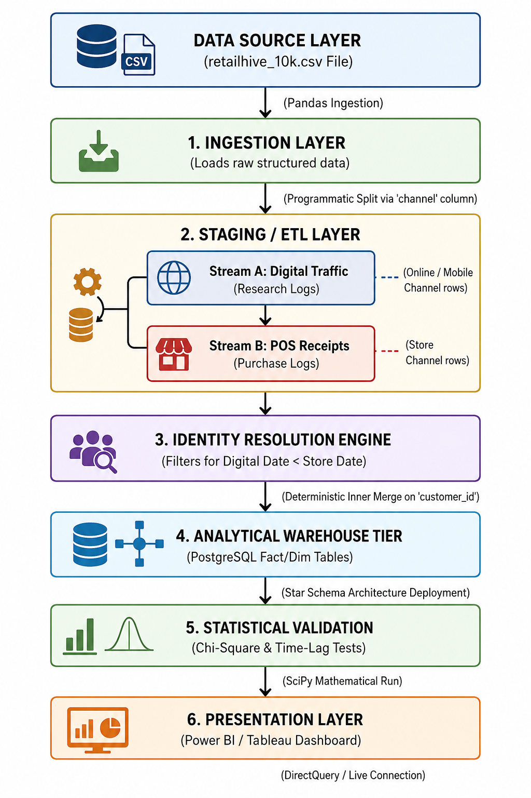
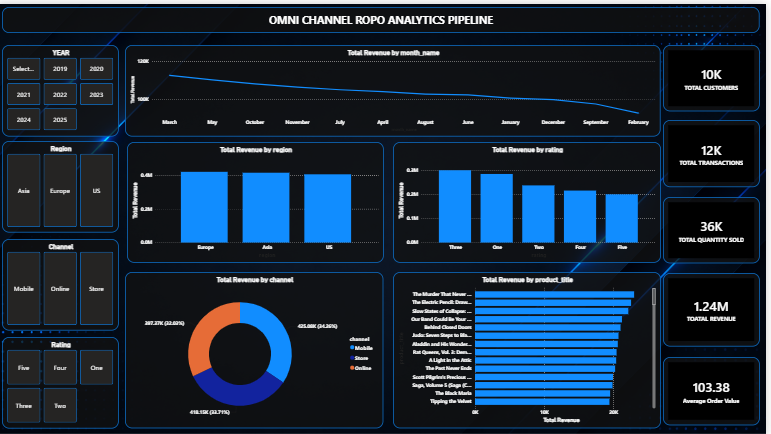

# Omnichannel ROPO Analytics Pipeline & Dashboard

An end-to-end data analytics project that connects online browsing behavior with offline store purchases to measure the true cross-channel impact of digital platforms.

**Tools:** Python (Pandas, NumPy, SciPy) · PostgreSQL · SQL · Power BI (DAX) · Jupyter Notebook

---

## Workflow



---

## Business Problem

Retailers often keep their app/website data and their physical store data in separate silos. When a customer researches a product online but buys it in a store, the website records an abandoned cart, and the store sale is never linked to the digital visit.

This is known as **ROPO (Research Online, Purchase Offline)**. This project builds a unified pipeline that links the two sides into a single customer view, so the real revenue influence of digital channels can be measured.

## Objectives

1. Build an ETL pipeline to ingest, clean, and merge online and in-store transaction data.
2. Measure the time lag and conversion between an online interaction and a store purchase.
3. Build an interactive Power BI dashboard to present the results to decision-makers.

## Dataset

- **Name:** RetailHive Omnichannel Transaction Database (`retailhive_10k.csv`)
- **Source:** Kaggle
- **Size:** 10,000 multi-channel transaction records

## Methodology

1. **Data ingestion and segregation:** The master dataset was split into a digital touchpoint log (Online/Mobile) and a physical store log (Store) using Python.
2. **Identity resolution:** The two streams were merged on `customer_id`, keeping only cases where the online interaction happened before the store purchase.
3. **Feature engineering:** Created `ROPO_Flag`, `Time_To_Conversion`, and `Conversion_Category`.
4. **Data warehouse:** Designed a PostgreSQL star schema with a fact table and customer, product, date, region, and channel dimension tables.
5. **Statistical validation:** Ran a Chi-Square Test of Independence and an Independent Samples T-Test.
6. **Dashboard:** Built a Power BI report with DAX measures.

## Dashboard

The Power BI dashboard has 5 KPI cards, 5 visualizations, and 4 slicers (Year, Region, Channel, Rating).




## Repository Structure

```
├── dashboard/            Power BI file (.pbix)
├── dashboard_overview/   Dashboard screenshots and workflow diagram
├── data/                 Raw dataset and processed dataset
├── notebooks/            Jupyter notebooks (analysis, data warehouse, statistical validation)
└── sql/                  PostgreSQL queries
```

## How to Run

1. Install Python 3 with Jupyter, Pandas, NumPy, SciPy, SQLAlchemy, and psycopg2.
2. Install PostgreSQL and create a database named `ROPO_Analytics`.
3. Open the notebooks in the `notebooks/` folder. In the database connection cell, replace `your_password` with your own PostgreSQL password.
4. Run the notebooks in order, then open the `.pbix` file in Power BI Desktop.

## Author

**Madhav Garg** · MCA, Jaypee Institute of Information Technology
[LinkedIn](https://www.linkedin.com/in/madhav-garg-15161a277/) · [GitHub](https://github.com/madhavgarg-08)
